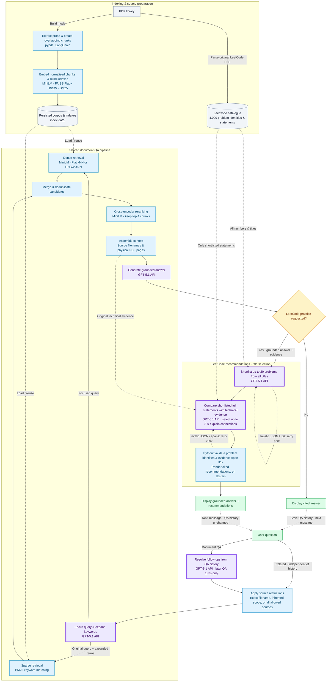

# Grounded Interview Prep RAG

I developed this project for my own interview preparation: I wanted grounded explanations of concepts in computer vision, machine learning, NLP, system design, and data systems, paired with related LeetCode problems to help me practice the underlying reasoning skills.

## Workflows

| Workflow | Pipeline |
|---|---|
| **Document QA** | PDF extraction and chunking → dense + BM25 retrieval → candidate deduplication → cross-encoder reranking → cited answers |
| **LeetCode practice** | Grounded QA answer → shortlist from all 4,000 problem titles → verify up to 20 full statements → recommend up to three cited problems |

Built with **pypdf**, **LangChain**, **Sentence Transformers/MiniLM**, **FAISS**, and **rank-bm25**. Generation defaults to **Azure OpenAI GPT-5.1**. Local **Qwen2.5-7B-Instruct** remains available for QA and the legacy recommendation workflow.

Features include **IndexFlat (exact k-nearest neighbors)** or **HNSW (approximate nearest neighbors, ANN)**, optional LLM query expansion, persistent BM25/Flat/HNSW indexes, conversational QA, and dense/BM25/expansion ablations. Exact quoted filenames restrict technical sources. Citations use one-based physical PDF pages.

## Pipeline flowchart

Purple boxes are **Azure OpenAI GPT-5.1 API calls**. Blue boxes run locally. Dashed arrows show reused data, retries, or the next chat turn. [Diagram notes](docs/pipeline-flowchart.md).

<!-- Keep this Mermaid block identical to docs/pipeline-flowchart.md. -->


## Run

1. Place the source PDFs in `documents/` and install [requirements.txt](requirements.txt): `pip install -r requirements.txt`.
2. Copy [.env.example](.env.example) to `.env` and set `AZURE_OPENAI_API_KEY` for Azure generation. Calls use your Azure quota and send the supplied passages to Azure.
3. In [config.yml](config.yml), use `indexing.mode: build` for the first run, then `load` to reuse `index-data/`. Models, prompts, chunking, retrieval, and ablations are configured there.

```bash
python main.py
```

Chat is enabled by default. Enter a normal question or `/related Hough transform in computer vision`. Use `exit` to stop. The optional recommendation modes are `titles` (default), `retrieval` (legacy), and `batched` (full statements, requiring higher Azure token quota).

Source PDFs, generated indexes, and `.env` are git-ignored. Conversation history stays in memory. `/related` runs independently of chat history.

## Sources

- Richard Szeliski. (2022). *[Computer Vision: Algorithms and Applications](https://szeliski.org/Book/)* (2nd ed.). Springer. Supplied PDF: final draft dated September 30, 2021.
- Martin Kleppmann. (2017). *[Designing Data-Intensive Applications: The Big Ideas Behind Reliable, Scalable, and Maintainable Systems](https://www.oreilly.com/library/view/designing-data-intensive-applications/9781491903063/)* (1st ed.). O'Reilly Media.
- Arslan Ahmad and the Design Gurus team. (n.d.). *[Grokking the System Design Interview](https://www.designgurus.io/course/grokking-the-system-design-interview)*. Design Gurus. Supplied PDF compilation is undated and does not credit its compiler.
- Kevin P. Murphy. (2023). *[Probabilistic Machine Learning: Advanced Topics](https://probml.github.io/pml-book/book2.html)*. MIT Press.
- Daniel Jurafsky and James H. Martin. (2026). *[Speech and Language Processing: An Introduction to Natural Language Processing, Computational Linguistics, and Speech Recognition with Language Models](https://web.stanford.edu/~jurafsky/slp3/)* (3rd ed., draft of August 19, 2026). Online manuscript.
- LeetCode. (n.d.). *[Problem set](https://leetcode.com/problemset/)*. Local source: *LeetCode Problems 1–4000 — Question Descriptions* (`LeetCode_4000_Problem_Reference.pdf`), a study compilation with no credited compiler.

## Evaluation

| Benchmark | Command | Report |
|---|---|---|
| [Document QA: 50 questions](evaluation-data/document-qa/) | `python evaluate_document_qa.py` | [Evidence text precision/recall](evaluation-results/document-qa/summary.md) |
| [LeetCode v2: 40 questions](evaluation-data/leetcode-recommendation/v2/) | `python evaluate_leetcode_recommendation.py` | [Final title-selection results](evaluation-results/leetcode-recommendation/v2/summary.md) |

Both scripts use the production pipeline. Optional command-line arguments:

- `--limit 1`: evaluate only the first question. Change the number to evaluate a larger subset, or omit it for the whole benchmark.
- `--resume` (LeetCode only): continue saved progress, skipping recorded questions, including failures. Keep the same limit, code, configuration, data, and indexes.
- `--restart` (LeetCode only): ignore saved progress and rerun the selected questions from scratch.

For example, `python evaluate_leetcode_recommendation.py --limit 5` evaluates five questions. Add `--resume` to continue that same run after an interruption. Completed reports replace files in their configured results directories.

QA measures annotated-passage overlap. LeetCode uses frozen relevance labels for assessed precision, hit rate, macro Capped Recall@k, and label coverage. Here `k` is the configured recommendation limit. [Metric definitions](evaluation-data/METRICS.md) explain the calculations and secondary full target recall. Labels are incomplete. The linked LeetCode report combines saved results with targeted reruns. These fixed development comparisons do not establish held-out generalization.

## Limitations

Figures, tables, layout, and scanned content are unsupported. BM25 scores every chunk rather than using an inverted index. Recommendation relationships remain model judgments. Source checks validate identities and quotes. Azure quota errors and answer truncation remain possible. Conversation sessions are not persisted, and no conversational benchmark is included.
