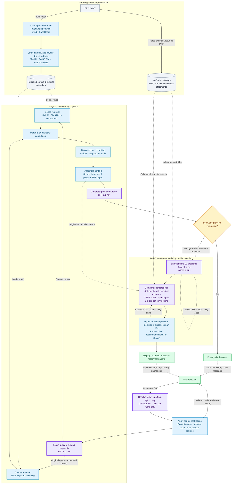

# Pipeline flowchart — draft

Current default workflows. Purple boxes are **Azure OpenAI API calls using GPT-5.1**. Blue boxes run locally. Dashed arrows show reused data, retries, or the next chat turn.

- **Build once, load later:** build mode persists both FAISS indexes and BM25. Load mode reuses the saved corpus and selected dense index. The LeetCode catalogue is parsed from the original PDF and cached in memory separately.
- **Source grounding:** `/related` retrieves technical evidence outside the LeetCode PDF. GPT-5.1 judges conceptual relationships. Python validates identities and citation spans, then formats the recommendations without another LLM call. Empty technical evidence or an empty shortlist skips the remaining selection calls.
- **Loops and settings:** chat continues until `exit` or `quit`. Each title-selection stage allows one corrective retry by default, then reports failure if still invalid. API rate-limit retries are omitted from the diagram. Retrieval toggles and numerical limits come from `config.yml`.
